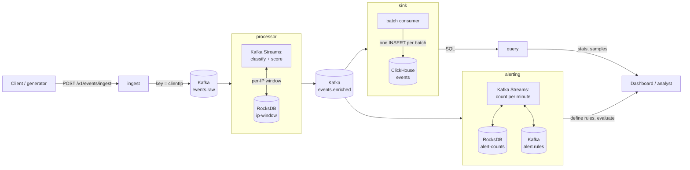

# Mini WSA: a mini security analytics pipeline

A Spring Boot service that ingests web-security events (DLRs), classifies and scores them, stores them in ClickHouse, and serves statistics and samples over a REST API. Alert rules are checked against the event stream with Kafka Streams.

## Quick start

Requirements: Docker with about 4 GB of free memory (the whole stack uses about 3.3 GB).

```bash
docker compose up --build -d --wait   # Kafka, ClickHouse and the app (5 roles); a few minutes the first time
curl -s localhost:8080/actuator/health
```

- **Ingest API:** `localhost:8080`
- **Query APIs:** `localhost:8081`
- **Alerting API:** `localhost:8082`
- **ClickHouse HTTP:** `localhost:8123` (user `wsa`, password `wsa`)

**Load test data:** `tools/EventGenerator.java` is a single file with no dependencies beyond the JDK (Java 17 or newer). It sends realistic events through the real ingest API.

```bash
java tools/EventGenerator.java --count 10000 --post http://localhost:8080
curl -s localhost:8081/v1/stats/summary        # the attack-wave IPs top the attackers list
```

- **Traffic:** 200 normal IPs, 4 configs, and timestamps over the last 6 hours, sent in time order.
- **Attack waves:** about 30% of the events. Each wave is one IP hitting one login or admin path 10 to 60 times, a few seconds apart. From the 7th event on, the repeat-offender bonus lifts its scores by 15.
- **Options:** `--seed N` for a reproducible set, and `--out events.json` to write a file instead (up to 5,000 events fit one `curl --data @events.json` request).
- **Speed:** on a laptop, 10,000 events were accepted in about 1 second. A summary query over them took about 30 to 40 ms.

**Live mode,** for watching it work in real time:

```bash
java tools/EventGenerator.java --live --post http://localhost:8080     # Ctrl+C to stop
```

It sends 10 events per second (`--rate N`) stamped "now". Every 2 minutes it adds a 30-second attack wave and prints its IP, path and category. A rule on that category fires during the wave and clears by itself before the next one (see Alerting below).

**Tests:** `./mvnw test` runs the unit tests in seconds (Java 25). `./mvnw verify` adds the integration tests, which need Docker for Testcontainers. They include `PipelineIT`, an end-to-end test against real Kafka and ClickHouse:
- It sends an attack wave and a calm event through the ingest API, then checks the summary numbers (including the +15 bonus), the samples order, filter and total, a 400, and the metrics.
- It also defines an alert rule and waits until the rule fires.

## Architecture



One codebase and one Docker image, run as 5 containers, one Spring profile (role) each, plus Kafka (KRaft, single broker) and ClickHouse. Each role loads only its own module, so the roles scale and fail independently, and heavy queries never slow down ingest. With no profile (tests, IDE), everything runs in one JVM.

1. **ingest** validates the request and produces each event to `events.raw`, keyed by `clientIp`, with `acks=all`. It answers **201** only after Kafka has stored the events.
2. **processor** (Kafka Streams) looks up the IP's recent events in its state store, adds `attackType` and `threatScore`, and writes the result to `events.enriched`.
3. **sink** polls up to 1,000 enriched events, writes them with one ClickHouse `INSERT`, and commits the Kafka offsets only after the insert succeeds. Rows are queryable about a second after the 201.
4. **query** runs the aggregations in ClickHouse. It never touches Kafka.
5. **alerting** is a second Kafka Streams app on `events.enriched`. It's a new consumer that plugs in without touching the other roles.

**Where data lives:**
- **Kafka:** the topics, as durable buffers between the roles.
- **ClickHouse:** the events.
- **RocksDB:** an embedded store on each Kafka Streams container's disk, backed up to a Kafka changelog topic, so a lost container rebuilds it.

**When something fails:**
- **Kafka down:** ingest answers 503 with `Retry-After`.
- **ClickHouse down:** the sink retries the batch forever, 1 s doubling up to 30 s by default (`wsa.sink.retry-initial`, `wsa.sink.retry-max`). Events wait in Kafka, and nothing is lost.
- **A bad event** never blocks the ones behind it: it's parked on the `events.failed` topic, with the reason in its headers.
  - The processor parks messages it can't read or enrich (Kafka Streams' built-in dead-letter handling).
  - When a batch insert fails, the sink checks ClickHouse with `SELECT 1`. If ClickHouse is down, it retries; if it's up, it inserts the events one by one and parks the ones ClickHouse refuses.
  - The parked event is the original, so it can be replayed into `events.raw`.

**Scaling:** each topic has 6 partitions, so up to 6 processor and 6 sink instances can share the work (`docker compose up --scale sink=3`). Kafka spreads the partitions and the per-IP state by itself. `ingest` and `query` are stateless. `alerting` runs as one instance for now.

## API

### Ingest

`POST /v1/events/ingest` takes one event or an array of up to 5,000 events.

```bash
curl -s -X POST localhost:8080/v1/events/ingest -H 'Content-Type: application/json' -d '{
  "eventId": "evt-00132", "timestamp": "2026-05-20T14:32:10Z", "configId": 14227,
  "policyId": "pol_web1", "clientIp": "203.0.113.42", "hostname": "www.example.com",
  "path": "/api/v1/login", "method": "POST", "statusCode": 403,
  "userAgent": "Mozilla/5.0 (Windows NT 10.0; Win64; x64)",
  "rule": { "id": "950001", "name": "SQL_INJECTION", "message": "SQL Injection Attack Detected",
            "severity": "CRITICAL", "category": "INJECTION" },
  "action": "DENY", "geoLocation": { "country": "CN", "city": "Beijing" },
  "requestSize": 1024, "responseSize": 256 }'
```
```json
{"ingested":1}
```

**Validation:**
- **Required:** `eventId`, `timestamp`, `configId`, `clientIp`, `path`, `method`, `rule.id`, `rule.severity`, `rule.category`, `action`.
- **Enums** are upper case.
- **`timestamp`** is ISO-8601 with a zone, at most 5 minutes in the future and at most 365 days old (`wsa.ingest.max-clock-skew`, `wsa.ingest.max-event-age`).
- **Numbers** must fit their ClickHouse columns.
- **Why the limits:** a bad value would otherwise break the pipeline after the 201. For example, Kafka refuses messages dated more than an hour ahead.

If any event is invalid, nothing is stored, and the response lists every problem by event index and field:

```bash
curl -s -X POST localhost:8080/v1/events/ingest -H 'Content-Type: application/json' -d '[
  {"eventId":"a","timestamp":"yesterday","configId":1,"clientIp":"1.1.1.1","path":"/","method":"GET",
   "rule":{"id":"1","severity":"LOW","category":"BOT"},"action":"DENY"},
  {"eventId":"b","timestamp":"2026-05-20T14:32:10Z","configId":1,"clientIp":"1.1.1.1","path":"/","method":"GET",
   "rule":{"id":"1","severity":"LOW","category":"BOT"},"action":"BLOCK"}]'
```
```json
{"errors":[
  {"index":0,"field":"timestamp","message":"must be an ISO-8601 timestamp with a zone, e.g. 2026-05-20T14:32:10Z"},
  {"index":1,"field":"action","message":"must be one of DENY, ALERT, MONITOR"}]}
```

**Status codes:**
- **201:** stored in Kafka.
- **400:** invalid request.
- **503:** Kafka didn't confirm in time. It comes with `Retry-After`; resend the whole request, since duplicates are harmless.

`receivedAt` is always set by the server. Every response carries an `X-Request-Id` header that also appears in the logs.

### Stats summary

`GET /v1/stats/summary?configId=&from=&to=` (port 8081). All parameters are optional:
- Without `configId`, all configs are counted.
- `from` and `to` are ISO-8601 UTC, with `from` inclusive and `to` exclusive. The default is the last 24 hours.

```bash
curl -s 'localhost:8081/v1/stats/summary?configId=777'
```
```json
{"configId":777,"timeRange":{"from":"2026-10-20T14:29:24Z","to":"2026-10-21T14:29:24Z"},"totalEvents":8,
 "byCategory":{"INJECTION":{"count":7,"avgThreatScore":77.1},"BOT":{"count":1,"avgThreatScore":10.0}},
 "byAction":{"DENY":7,"MONITOR":1},
 "topAttackers":[{"clientIp":"203.0.113.9","count":7,"avgThreatScore":77.1},{"clientIp":"198.51.100.5","count":1,"avgThreatScore":10.0}],
 "topTargetedPaths":[{"path":"/admin/users","count":7},{"path":"/products","count":1}]}
```

- All aggregation runs in ClickHouse.
- Averages are rounded to one decimal, and the top lists hold up to 10 entries by count.
- The summary is 5 small queries, one per block.
- **No `FINAL`:** a batch the sink re-delivers is counted twice until ClickHouse merges duplicates in the background. `FINAL` would slow every query.

### Samples

`GET /v1/events/samples?configId=&from=&to=&category=&action=&limit=&offset=` (port 8081). Every filter is optional:
- `limit` is 1 to 100 (default 20), and `offset` is 0 or more.
- Results are newest first, with `eventId` breaking ties so paging is stable.
- `total` counts every match, not just this page.

```bash
curl -s 'localhost:8081/v1/events/samples?configId=777&category=INJECTION&limit=2'
```
```json
{"total":7,"limit":2,"offset":0,"events":[
  {"eventId":"s15198-6","timestamp":"2026-10-21T14:24:53Z","receivedAt":"2026-10-21T14:28:53.913Z",
   "configId":777,"clientIp":"203.0.113.9","path":"/admin/users","method":"POST",
   "rule":{"id":"1","severity":"CRITICAL","category":"INJECTION", ...},"action":"DENY",
   "attackType":"SQL/Command Injection","threatScore":90, ...},
  {"eventId":"s15198-5", ...}]}
```

Each event has all the original fields plus `receivedAt`, `attackType` and `threatScore`. Fields that weren't sent come back as `null`.

### Alerting (bonus)

Rules like "more than 50 INJECTION events within 10 minutes", checked against events as they stream in. Port 8082.

```bash
curl -s -X POST localhost:8082/v1/alerts/define -H 'Content-Type: application/json' \
  -d '{"name":"SQLi burst","category":"INJECTION","threshold":50,"windowMinutes":360}'
curl -s localhost:8082/v1/alerts/evaluate
```
```json
{"evaluatedAt":"2026-10-21T18:19:29Z","rulesChecked":1,
 "firing":[{"ruleId":"b9e16a75-7725-4dc2-a86b-bc3a95e7f5a1","name":"SQLi burst","category":"INJECTION",
            "configId":null,"threshold":50,"windowMinutes":360,"count":2317}]}
```

The example uses a 6-hour window, because batch-generated events are spread over the last 6 hours. With live mode, use a short one (for example `"threshold":150,"windowMinutes":1`).

**The rule:**
- `category`, `threshold` and `windowMinutes` (1 to 1440) are required. `name` and `configId` are optional; no `configId` means all configs.
- A rule fires when **count > threshold**, counting the events whose own timestamp falls in the last `windowMinutes`.

**How it works:**
- **Rules** go to the compacted topic `alert.rules`, which acts as the rules' database. The app reads it into a `GlobalKTable`, so every instance has all the rules.
- **Counting:** each event is counted per minute under its config and category (`14227|INJECTION`), and again for all configs (`*|INJECTION`). The counts live in a window store kept for a day.
  - Every category is counted, not only those with rules, so a new rule sees the past day at once.
- **Evaluate** sums each rule's per-minute counts straight from the stores (interactive queries). It answers 503 while the app is starting or rebalancing.
- **Late events:** an event up to a day late (a backfill, a replay, a second generator run) still counts in its own minute. See "What was challenging".

## Threat score

| Rule | Points |
|---|---|
| Severity CRITICAL / HIGH / MEDIUM / LOW | 40 / 30 / 20 / 10 |
| Action DENY / ALERT / MONITOR | +20 / +10 / +0 |
| Path contains `/admin` or `/login` (any case) | +15 |
| More than 5 events from the same IP in the last 10 minutes | +15 |

Capped at 100; the highest reachable score with these rules is 90, so the cap guards future rules. Each event also gets an `attackType` from its `rule.category`, for example `INJECTION` → "SQL/Command Injection" (all 7 as in the brief).

**The repeat-offender window:**
- **What counts:** the IP's *earlier* events in the 10 minutes before this event, by the events' own timestamps. The event itself doesn't count, and one exactly 10 minutes older still does. Using event time means loading 6 hours of events in seconds doesn't turn every IP into a repeat offender.
- **Where it lives:** in the processor's state store `ip-window`. Events are keyed by `clientIp`, so all events of an IP reach the same task in order: correct with any number of instances, with no locks and no Redis.
- **Bounded memory:** only the newest 6 events per IP are kept (enough to answer "more than 5?"), and idle IPs are removed. A re-delivered `eventId` isn't counted twice.
- **Trade-off:** an event older than the 6 kept ones can be under-counted.

Example: 7 `CRITICAL`/`DENY` events from one IP on `/admin/users`, one minute apart. The first six score 75, and the seventh scores 90.

## Monitoring

Each container exposes `/actuator/health` and `/actuator/prometheus`. Our own metrics start with `wsa_` (`curl -s localhost:8080/actuator/prometheus | grep '^wsa_'`). The ones to watch:
- **Consumer lag** (`kafka_consumer_fetch_manager_records_lag_max`): it grows when the processor or sink can't keep up.
- **Rejected events:** `wsa_ingest_events_total{result="rejected"}`.
- **503s:** `wsa_ingest_publish_failures_total`.
- **Insert batch size:** `wsa_sink_batch_size`; small batches mean too many inserts for ClickHouse.
- **Failed inserts:** `wsa_sink_insert_failures_total`.
- **Parked events:** `wsa_sink_failed_total`.
- **Repeat-offender bonuses:** `wsa_enrich_repeat_offenders_total`.
- **Firing alerts:** `wsa_alerting_firing`.

## Why ClickHouse

The workload is analytics over a huge, append-only stream: count, group by and average over millions or billions of events in a time range, plus fetching a few raw rows. That's what a columnar OLAP database is built for.

- **Reads only what a query needs:** a query reads only the columns it uses. The sort key `(configId, timestamp, eventId)` turns the config and time filter into a range scan.
- **Fast aggregations** in SQL, with no counting in Java.
- **Compression:** repetitive columns like category and action shrink 10x or more.
- **Cheap retention:** there's one partition per day.
- **De-duplication:** a `ReplacingMergeTree` merges the duplicates that at-least-once delivery can create.

**Trade-offs:** it wants few, large inserts (hence the batching sink), duplicates merge in the background, and updates are expensive. None of these matter for an event log.

**Alternatives I considered:**
- **Postgres:** simpler, but a row store, slow to aggregate billions of rows.
- **Elasticsearch:** costly for aggregations.
- **Druid/Pinot:** similar to ClickHouse, with more moving parts.

## Design decisions

- **ClickHouse for storage:** an open-source columnar database, picked for the queries the brief requires. They're all counts, group-bys, averages and top-10 lists per config and time range, plus filtered samples: many rows, few columns.
- **Kafka between ingest and processing:** the API only validates and hands off, so a slow database never slows ingest. Kafka is the durable buffer, 503 is real backpressure, and new consumers (like alerting) read the same topics.
- **Kafka, not ClickHouse async inserts:** async inserts would be simpler, but their buffer lives in ClickHouse's memory, so a crash loses it. They also give no backpressure, no replay, no other consumers, and less control over batching.
- **The repeat-offender window in a Kafka Streams state store, keyed by IP:** see Threat score. Event time, bounded memory, no Redis.
- **At-least-once from start to finish:** offsets are committed only after the work is done. Duplicates are harmless: the window skips known event ids, and ClickHouse merges duplicate rows.
- **Validate at the edge, trust inside:** ingest rejects bad requests, including values that would break later stages. Anything that still fails inside is parked, never blocking.
- **One image and five roles, not five services yet:** one codebase keeps building, testing and versioning simple at this size. As the roles grow apart, I'd split them into separate modules and images with their own releases (the query role wouldn't carry Kafka Streams). The packages are already shaped for that: modules depend only on `common`.
- **Alerting as a stream, not SQL on demand:** a SQL count per rule would be simpler and fits a pull API, but it re-scans ClickHouse on every call for every rule. Streaming counts each event once and leads naturally to push alerts.
- **Explicit wiring, plain classes:**
  - No classpath scanning: `MiniWsaApplication` imports one `@Configuration` per module, and each config creates its beans with `new`. Reading a config shows its module's whole wiring, and its `@Profile` decides which role loads it.
  - The logic (scoring, services, the sink's batch handling, the topologies) is plain Java with no Spring imports. Spring stays at the edges: configs, controllers, and the Kafka and ClickHouse adapters.
- **Layers behind interfaces and tests at every level:**
  - Code flows controllers → services → repositories and publishers.
  - Unit tests use mocks and assert behavior and metrics. The topologies run in memory (`TopologyTestDriver`).
  - Integration tests run against real Kafka and ClickHouse, including the end-to-end test.

## What I'd improve with more time

Most important first.

1. **Autoscaling on the right metric for each role.**
   - **processor, sink, alerting:** scale on **consumer lag**, for example with KEDA's Kafka scaler.
   - **ingest:** scale on request rate, latency and 503s.
   - **query:** scale on query latency and CPU.
   - **ClickHouse:** watch insert latency and batch size.
   - Parallelism is capped by the partition count, so I'd create topics with many more partitions up front (for example 48). Adding partitions later moves IPs to other partitions and splits their per-IP state.
2. **High availability and retention.**
   - **Kafka:** replication factor 3 with `min.insync.replicas=2`.
   - **ClickHouse:** a replicated table, sharded by `configId` behind a distributed table.
   - **Retention:** `TTL` on the table and on the topics.
3. **Alerts on the system itself.** The metrics exist; next come Prometheus alert rules (lag growing, 503 rate, parked events, insert failures) and a Grafana dashboard per role.
4. **Query performance at scale.**
   - Pre-aggregated per-minute tables (materialized views) for the summary.
   - One `GROUPING SETS` query instead of 5.
   - Keyset paging for samples instead of offsets.
5. **Hot-IP skew.** A single flooding IP lands on a single partition. Detect hot keys and salt them (spread one IP over several partitions, then combine its counts), or route them to a separate topic.
6. **Scoring rules per customer.** Today the weights are code: reviewed and unit-tested, which fits a fixed spec. A real product lets each customer tune them, so they'd live in a rules store (a database, or a compacted topic like `alert.rules`) and change without a deploy.
7. **Exactly-once.** Kafka Streams `exactly_once_v2`, plus de-duplication on insert, would remove the rare duplicate rows that queries can count until ClickHouse merges them.
8. **Bigger inserts at low traffic.** One sink consumer with a longer fetch wait gives fewer, larger inserts, at the cost of about a second of extra latency. An alternative is ClickHouse's own Kafka engine or Kafka Connect instead of our consumer: fewer moving parts, but less control over retries and parking bad events.
9. **Security.**
   - Authentication on the APIs, with each client limited to its own `configId`s.
   - Rate limiting.
   - TLS and SASL to Kafka and ClickHouse.
10. **Schemas.** Avro with a schema registry on the topics, for smaller messages and safe schema changes between roles.
11. **Alerting beyond one instance.**
    - Route evaluate calls to the instance that owns each count key (`KafkaStreams#queryMetadataForKey`).
    - Push "started / stopped firing" to an `alerts` topic for notifications and history.
12. **Operations polish:**
    - A Kafka health check in `/actuator/health`.
    - Static group membership, so a redeployed processor doesn't wait about 40 s to rebalance.
    - A replay tool for `events.failed`.
    - Processing time as the Kafka message time.

## What was challenging

- **The repeat-offender rule at scale.** "More than 5 events from this IP in 10 minutes" sounds simple. But it has to stay correct with several processor instances, restarts, re-delivered events and old data loaded fast.
  - Keying Kafka by IP gives each IP a single owner, so there are no shared counters.
  - The changelog-backed state store survives restarts.
  - Event time handles fast loads.
  - Keeping the last 6 event ids handles both re-delivery and memory.
  - I wrote the rule as a plain function (history, event) → (decision, new history), so its edge cases are unit-tested without Kafka.
- **One bad event must not stop the pipeline.** While testing edge cases I found that Kafka 4 refuses messages dated more than an hour in the future, and ClickHouse refuses one insert spanning more than 100 daily partitions. Our retry-forever handlers would have stalled on such events.
  - The fix has two layers: ingest rejects such values up front, and anything that still fails is parked on `events.failed` with its reason.
  - The sink tells "ClickHouse is down" (retry) apart from "this event is bad" (park it) with a quick `SELECT 1`.
- **Alert counts that silently fell short.** In Docker, an alert's count stayed far below ClickHouse's count for the same window, even though the app had read every event.
  - **The cause:** Kafka Streams' grace period. A windowed count drops events that arrive more than the grace period behind the newest one seen, and a second generator run sends events hours "late".
  - **The fix:** I reproduced it in a `TopologyTestDriver` test first, then set the grace period to the longest rule window (a day). The counts then matched ClickHouse exactly.

## One thing I learned

Kafka Streams state stores. I had used Kafka for consumers and pipelines, but not stateful stream processing. I learned the model from the Kafka Streams docs and by testing the topology in memory with `TopologyTestDriver`, then checked it against a real broker:
- A local RocksDB store per partition.
- A changelog topic that restores it after a restart.
- Punctuators driven by event time.

It replaced the Redis I first had in mind for the per-IP window, with less to run. The alerting bonus took it further:
- Window stores for per-minute counts.
- A `GlobalKTable` fed by a compacted topic, as a small rules database.
- Interactive queries that answer an HTTP request straight from the stream's state.
- Grace periods, learned the hard way.

## Milestones

`v0.1-ingestion` · `v0.2-enrichment` · `v0.3-stats` · `v0.4-samples` · `v0.5-generator` · `v0.6-alerting` · `v1.0` (the submission) · `v1.1` (explicit bean wiring with the logic in plain Java, and the generator's live mode)
