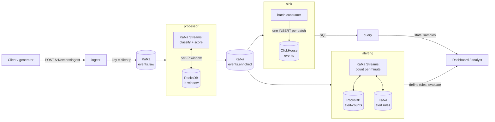

# Mini WSA: a mini security analytics pipeline

A Spring Boot service that ingests web-security events (DLRs), classifies and scores them, stores them in ClickHouse, and serves statistics and samples over a REST API. Alert rules are checked against the event stream with Kafka Streams.

## Quick start

Requirements: Docker with about 4 GB of free memory (the whole stack uses about 3.3 GB).

```bash
docker compose up --build -d --wait   # Kafka, ClickHouse and the app (5 roles); a few minutes the first time
curl -s localhost:8080/actuator/health
```

- Ingest API: `localhost:8080` (the `ingest` container)
- Query APIs: `localhost:8081` (the `query` container)
- Alerting API: `localhost:8082` (the `alerting` container)
- ClickHouse HTTP: `localhost:8123` (user `wsa`, password `wsa`)

Build and test the app without Docker: Java 25, then `./mvnw test` (unit tests, seconds) or `./mvnw verify` (adds the integration tests, which need Docker for Testcontainers). The integration tests include `PipelineIT`, an end-to-end test against real Kafka and ClickHouse:
- It posts an attack wave and a calm event to the ingest API.
- It waits until they're queryable, then checks the summary numbers (including the +15 repeat-offender score), the samples order, filter and total, a 400, and the `wsa_*` metrics.
- It defines an alert rule, sends a wave, and waits until the rule fires.

### Load test data

`tools/EventGenerator.java` is a single-file program with no dependencies beyond the JDK. It makes realistic events and sends them through the real ingest API:

```bash
java tools/EventGenerator.java --count 10000 --post http://localhost:8080
curl -s localhost:8081/v1/stats/summary        # the attack-wave IPs top the attackers list
```

- **Normal traffic:** 200 IPs with a fixed country each, 4 configs, typical paths and user agents. Rule ids and names match their category.
- **Attack waves:** about 30% of the events. Each wave is one IP hitting one path (`/api/v1/login`, `/admin`, `/wp-login.php`) 10 to 60 times, every 2 to 20 seconds. From the 7th event of a wave on, the IP is a repeat offender and its scores jump by 15.
- **Timestamps:** spread over the last 6 hours, so the default 24-hour window shows them. Events are sent in time order, like a real edge would send them.
- **Options:**
  - `--batch N`: events per request (default 500).
  - `--seed N`: a reproducible data set.
  - `--out events.json`: writes a JSON array to the file instead of sending it. Up to 5,000 events fits one `curl --data @events.json` request.

On a laptop (the whole stack in Docker), 10,000 events were accepted in about 1 second. A summary query over them took about 30 to 40 ms.

**Live mode, for watching it work in real time:**

```bash
java tools/EventGenerator.java --live --post http://localhost:8080     # Ctrl+C to stop
```

- **Traffic:** it sends 10 events per second (`--rate N`) stamped "now".
- **Waves:** every 2 minutes, a 30-second attack wave adds 10 events per second from one IP, and it prints which IP, path and category.
- **Alerts:** a rule on the wave's category fires during the wave and clears by itself before the next one:

```bash
curl -s -X POST localhost:8082/v1/alerts/define -H 'Content-Type: application/json' \
  -d '{"name":"live burst","category":"INJECTION","threshold":300,"windowMinutes":1}'
curl -s localhost:8082/v1/alerts/evaluate      # firing during the wave, empty about a minute after it
```

In a test run, the rule fired while the wave was running and cleared 47 seconds after the wave ended. The stats showed the wave's IP as top attacker within seconds.

## How it works, in three lines

1. `POST /v1/events/ingest` validates the events and writes them to the Kafka topic `events.raw`, keyed by `clientIp`. It answers **201** only after Kafka has stored them.
2. A Kafka Streams processor enriches each event (attack type, threat score) and writes it to `events.enriched`.
3. A batch consumer reads `events.enriched` and inserts each batch into ClickHouse with one `INSERT`. The query APIs read from ClickHouse.

Rows become queryable about a second after the 201.

### When something fails

- **Kafka down:** ingest answers 503 with `Retry-After`. Nothing is half-stored that the client doesn't know about.
- **ClickHouse down:** the sink retries the batch with growing pauses (up to 30 s), forever. Events wait in Kafka, and nothing is lost.
- **A bad event** never blocks the events behind it. It's parked on the `events.failed` topic, with the reason in the message headers:
  - The processor parks messages it can't read or enrich, using Kafka Streams' built-in dead-letter handling (`errors.dead.letter.queue.topic.name`).
  - The sink parks events ClickHouse refuses while it's otherwise up. When a batch insert fails, it checks with `SELECT 1`: if ClickHouse is down, it retries the batch; if it's up, it inserts the events one by one and parks the ones that fail. The metric is `wsa_sink_failed_total`.
  - The parked event is the original one, so it can be replayed into `events.raw` once the cause is fixed.

```bash
docker compose exec kafka /opt/kafka/bin/kafka-console-consumer.sh --bootstrap-server localhost:9092 \
  --topic events.failed --from-beginning --formatter-property print.headers=true
```

## API

### Ingest

`POST /v1/events/ingest` takes one event or an array of up to 5,000 events.

```bash
curl -s -X POST localhost:8080/v1/events/ingest -H 'Content-Type: application/json' -d '{
  "eventId": "evt-00132", "timestamp": "2026-05-20T14:32:10Z", "configId": 14227,
  "policyId": "pol_web1", "clientIp": "203.0.113.42", "hostname": "www.example.com",
  "path": "/api/v1/login", "method": "POST", "statusCode": 403,
  "userAgent": "Mozilla/5.0 (Windows NT 10.0; Win64; x64)",
  "rule": { "id": "950001", "name": "SQL_INJECTION", "message": "SQL Injection Attack Detected",
            "severity": "CRITICAL", "category": "INJECTION" },
  "action": "DENY", "geoLocation": { "country": "CN", "city": "Beijing" },
  "requestSize": 1024, "responseSize": 256 }'
```
```json
{"ingested":1}
```

An array works the same way: `-d '[{...}, {...}]'` returns `{"ingested":2}`.

**Validation.** Required: `eventId`, `timestamp`, `configId`, `clientIp`, `path`, `method`, `rule.id`, `rule.severity`, `rule.category`, `action`. Enums are upper case. `timestamp` is ISO-8601 with a zone, at most 5 minutes in the future and at most 365 days old (`wsa.ingest.max-clock-skew`, `wsa.ingest.max-event-age`; raise the age for a one-off backfill). Numbers must fit their columns (`statusCode` 0–65535; `configId`, `requestSize`, `responseSize` 0–4294967295). These limits stop a bad value from breaking the pipeline after the 201: Kafka refuses messages dated more than an hour ahead, and Kafka Streams drops events before 1970. If any event is invalid, nothing is stored, and the response lists the problems by event index and field:

```bash
curl -s -X POST localhost:8080/v1/events/ingest -H 'Content-Type: application/json' -d '[
  {"eventId":"a","timestamp":"yesterday","configId":1,"clientIp":"1.1.1.1","path":"/","method":"GET",
   "rule":{"id":"1","severity":"LOW","category":"BOT"},"action":"DENY"},
  {"eventId":"b","timestamp":"2026-05-20T14:32:10Z","configId":1,"clientIp":"1.1.1.1","path":"/","method":"GET",
   "rule":{"id":"1","severity":"LOW","category":"BOT"},"action":"BLOCK"}]'
```
```json
{"errors":[
  {"index":0,"field":"timestamp","message":"must be an ISO-8601 timestamp with a zone, e.g. 2026-05-20T14:32:10Z"},
  {"index":1,"field":"action","message":"must be one of DENY, ALERT, MONITOR"}]}
```

Status codes: **201** stored in Kafka · **400** invalid request · **503** Kafka didn't confirm in time (with `Retry-After`; resend the whole request, duplicates are harmless).

`receivedAt` is always set by the server. Every response carries an `X-Request-Id` header, which also appears in the logs.

### Stats summary

`GET /v1/stats/summary?configId=&from=&to=` (on the query container, port 8081). All parameters are optional:
- `configId`: without it, all configs are counted.
- `from` / `to`: ISO-8601 UTC. `from` is inclusive and `to` exclusive. Without them, the range is the last 24 hours; `from` must be before `to`.

```bash
curl -s 'localhost:8081/v1/stats/summary?configId=777'
```
```json
{"configId":777,"timeRange":{"from":"2026-10-20T14:29:24Z","to":"2026-10-21T14:29:24Z"},"totalEvents":8,
 "byCategory":{"INJECTION":{"count":7,"avgThreatScore":77.1},"BOT":{"count":1,"avgThreatScore":10.0}},
 "byAction":{"DENY":7,"MONITOR":1},
 "topAttackers":[{"clientIp":"203.0.113.9","count":7,"avgThreatScore":77.1},{"clientIp":"198.51.100.5","count":1,"avgThreatScore":10.0}],
 "topTargetedPaths":[{"path":"/admin/users","count":7},{"path":"/products","count":1}]}
```

**Details:**
- Every aggregation runs in ClickHouse.
- Averages are rounded to one decimal.
- Categories and actions appear only if they have events, biggest first.
- The top lists hold up to 10 entries, sorted by count. Ties sort by IP or path as text.
- The summary is 5 small queries, one per block. Inserts landing between them can make the blocks differ by a few events. At scale, one query with `GROUPING SETS`, or pre-aggregated tables, would fix both the consistency and the cost.
- **No `FINAL`:** a batch the sink re-delivers is counted twice until ClickHouse merges the duplicates in the background. `FINAL` would slow every query.

### Samples

`GET /v1/events/samples?configId=&from=&to=&category=&action=&limit=&offset=` (port 8081). Every filter is optional:
- `configId`, `from` and `to` work as in the summary.
- `category` and `action` take the upper-case enum values.
- `limit` is 1 to 100, default 20. `offset` is 0 or more.
- Results are newest first, with `eventId` breaking ties so paging is stable.
- `total` counts every match, not just this page.

```bash
curl -s 'localhost:8081/v1/events/samples?configId=777&category=INJECTION&limit=2'
```
```json
{"total":7,"limit":2,"offset":0,"events":[
  {"eventId":"s15198-6","timestamp":"2026-10-21T14:24:53Z","receivedAt":"2026-10-21T14:28:53.913Z","configId":777,
   "policyId":null,"clientIp":"203.0.113.9","hostname":null,"path":"/admin/users","method":"POST","statusCode":null,
   "userAgent":null,"rule":{"id":"1","name":null,"message":null,"severity":"CRITICAL","category":"INJECTION"},
   "action":"DENY","geoLocation":null,"requestSize":null,"responseSize":null,
   "attackType":"SQL/Command Injection","threatScore":90},
  {"eventId":"s15198-5", ...}]}
```

Each event has the original fields plus `receivedAt`, `attackType` and `threatScore`. Optional fields that weren't sent come back as `null`.

**Paging:** limit/offset is what the brief asks for. Deep offsets get slower, because ClickHouse still reads the skipped rows. At scale, keyset paging would fix that: the client sends the last `(timestamp, eventId)` it saw.

### Alerting (bonus)

Rules like "more than 50 INJECTION events within 10 minutes", checked against events as they stream in. Port 8082. The example uses a 6-hour window because the generator spreads its events over the last 6 hours.

```bash
curl -s -X POST localhost:8082/v1/alerts/define -H 'Content-Type: application/json' \
  -d '{"name":"SQLi burst","category":"INJECTION","threshold":50,"windowMinutes":360}'
```
```json
{"id":"b9e16a75-7725-4dc2-a86b-bc3a95e7f5a1","name":"SQLi burst","category":"INJECTION","configId":null,"threshold":50,"windowMinutes":360}
```
```bash
curl -s localhost:8082/v1/alerts/evaluate
```
```json
{"evaluatedAt":"2026-10-21T18:19:29Z","rulesChecked":1,
 "firing":[{"ruleId":"b9e16a75-7725-4dc2-a86b-bc3a95e7f5a1","name":"SQLi burst","category":"INJECTION",
            "configId":null,"threshold":50,"windowMinutes":360,"count":2317}]}
```

**The rule:**
- `category`, `threshold` (0 or more) and `windowMinutes` (1 to 1440) are required. `name` and `configId` are optional; no `configId` means all configs. A bad value gets a 400.
- A rule fires when **count > threshold**. The count covers the events whose own timestamp falls in the last `windowMinutes`, ending now.

**How it works:** the `alerting` role is its own Kafka Streams app, reading `events.enriched`. No external database: its state lives in embedded RocksDB stores on its own disk, backed up to Kafka changelog topics.
- **Rules** are written to the compacted topic `alert.rules`, which acts as the rules' database: Kafka keeps the latest version of every rule. The app reads that topic into a `GlobalKTable`, so every instance has all rules.
- **Counts:**
  - Each event is counted per minute under its config and category (`14227|INJECTION`), and again for all configs (`*|INJECTION`).
  - The counts live in a window store (RocksDB plus a changelog), kept for a day.
  - Counting covers every category and config, not only those with rules, so a new rule sees the past day at once. On its first start the app reads the topic from the beginning.
- **Evaluate** reads the rules and sums each rule's per-minute counts straight from the stores ("interactive queries"). Counts are per whole minute, so a window starts at the beginning of its first minute.
- **Late events:** an event arriving up to a day late, from a backfill, replay or generator run, is still counted in its own minute. With Kafka Streams' default grace period, late events were silently dropped, and the counts fell far below ClickHouse's. A test now covers it.
- **While the app is starting or rebalancing,** evaluate answers 503 with `Retry-After`.

**Limits, and what's next:**
- **One alerting instance:** with several, each instance holds only some count keys, so evaluate would have to ask the instance that owns each key (`KafkaStreams#queryMetadataForKey`, then forward the request).
- **Pull only, as the brief asks.** The natural next step is push: check the rules whenever a count changes and publish "started firing / stopped firing" to an `alerts` topic. Something like Slack or a pager would consume that topic, and a sink could store the alert history.
- **Duplicates:** an at-least-once replay of `events.enriched` can count an event twice.
- **Not built:** deleting or updating rules (a tombstone or a new version on `alert.rules` would do it).

## Threat score

| Rule | Points |
|---|---|
| Severity CRITICAL / HIGH / MEDIUM / LOW | 40 / 30 / 20 / 10 |
| Action DENY / ALERT / MONITOR | +20 / +10 / +0 |
| Path contains `/admin` or `/login` | +15 |
| More than 5 events from the same IP in the last 10 minutes (event time) | +15 |

Capped at 100. Note: the highest reachable score with these rules is 90; the cap guards future rules.

Each event also gets an `attackType` from its `rule.category` (`INJECTION` → "SQL/Command Injection", `XSS` → "Cross-Site Scripting", `PROTOCOL_VIOLATION` → "Protocol Anomaly", `DATA_LEAKAGE` → "Data Exfiltration", `BOT` → "Bot Activity", `DOS` → "Denial of Service", `RATE_LIMIT` → "Rate Limiting").

**Details:**
- The path rule is case-insensitive (`/Admin/users` counts).
- **Repeat offender:** the event's IP had more than 5 *earlier* events within the 10 minutes before this event. The event itself doesn't count, and an event exactly 10 minutes older still does.
- **Event time, not arrival time:** the window uses the events' own `timestamp`. Loading 6 hours of generated events in a few seconds doesn't turn every IP into a repeat offender.

**Where the window lives:**
- In the Kafka Streams processor, as a state store (`ip-window`) keyed by IP. Events are keyed by `clientIp` in Kafka, so all events of one IP reach the same processor task, in order. The counts stay correct with any number of processor instances, with no locks and no Redis.
- The store is local (RocksDB) and backed up to a Kafka changelog topic, so the processor remembers IPs across restarts.
- **Bounded memory:** only the newest 6 events per IP are kept, which is enough to answer "more than 5?". A flooding IP costs the same memory as any other. IPs idle for 10 minutes are removed.
- **Trade-off:** an event that arrives very late (older than the 6 kept events) can be under-counted.

Example: 7 `CRITICAL`/`DENY` events from one IP on `/admin/users`, one minute apart. The first six score 75, and the seventh scores 90.

## Deployment

One codebase and one Docker image. `docker compose` runs it as 5 containers, one Spring profile (role) each: `ingest`, `processor`, `sink`, `query` and `alerting`. Each role loads only its own module, so the roles scale and fail independently. Heavy queries never slow down ingest. With no profile set (tests, IDE), all roles run in one process.

## Monitoring

Each container exposes `/actuator/health` (including ClickHouse) and `/actuator/prometheus`. The pipeline's own metrics are prefixed `wsa_`:

```bash
curl -s localhost:8080/actuator/prometheus | grep '^wsa_'
```

**Ingest:**
- `wsa_ingest_events_total{result="accepted"|"rejected"}`: events in, and events that failed validation.
- `wsa_ingest_publish_seconds`: time to get Kafka's acks per request.
- `wsa_ingest_publish_failures_total`: requests answered with 503.

**Processor:**
- `wsa_enrich_events_total`: events scored.
- `wsa_enrich_repeat_offenders_total`: events that got the +15 bonus.
- `wsa_enrich_threat_score`: the score distribution.

**Sink:**
- `wsa_sink_batch_size`: events per ClickHouse insert (small batches mean too many inserts).
- `wsa_sink_insert_seconds`: insert latency.
- `wsa_sink_insert_failures_total`: failed inserts.
- `wsa_sink_failed_total`: events parked on `events.failed`.
- `wsa_sink_skipped_total`: unreadable messages.

**Alerting:**
- `wsa_alerting_rules_defined_total`: rules saved.
- `wsa_alerting_firing`: how many rules fired per evaluation.

**For free:**
- HTTP latency per endpoint (`http_server_requests_seconds`).
- JVM metrics.
- Kafka client and Streams metrics, including consumer lag (`kafka_consumer_fetch_manager_records_lag_max`). Lag is the first thing to watch: it grows when the processor or sink can't keep up.

## Architecture



**Where data lives:**
- **Kafka:** the topics, which act as durable buffers between the roles.
- **ClickHouse:** the events, for the query APIs.
- **RocksDB:** an embedded key-value store on each Kafka Streams container's local disk, holding its state. Every RocksDB store is backed up to a Kafka changelog topic (not drawn), so a lost container rebuilds it from Kafka.

Not drawn either: events the processor or sink can't handle go to the `events.failed` topic (see "When something fails").

One image runs as five containers (Spring profiles), plus Kafka (KRaft, single broker) and ClickHouse.

**Write path:**
1. `ingest` validates the request and produces each event to `events.raw`, keyed by `clientIp`, with `acks=all`. It answers 201 only after Kafka has stored the events, and 503 if Kafka is down.
2. The `processor` (Kafka Streams) reads `events.raw`, looks up the IP's recent events in its state store, and scores the event. It writes the result to `events.enriched`.
3. The `sink` polls up to 1,000 enriched events and writes them with one ClickHouse `INSERT`. It commits the Kafka offsets only after the insert succeeds.

**Read path:** `query` runs the aggregations in ClickHouse and returns JSON. It never touches Kafka.

**Alerting path:** `alerting` is a second Kafka Streams app on `events.enriched`. It counts events per minute per category and config, and answers `evaluate` from its own state stores. That proves the point of the topics: new consumers plug in without touching ingest or the processor.

**Scaling:**
- Each topic has 6 partitions, so up to 6 processor and 6 sink instances can share the work (`docker compose up --scale sink=3`).
- Kafka spreads the partitions and the per-IP state across instances by itself.
- `ingest` and `query` are stateless, so they scale behind a load balancer.
- `alerting` runs as one instance for now (see its limits above).

## Why ClickHouse

The workload is analytics over a huge, append-only stream: count, group by and average over millions or billions of events in a time range, plus fetching a few raw rows. That's what a columnar OLAP database is built for.

- **Reads only what a query needs:** "events by category for config X today" reads 3 columns of one config's time slice, not whole rows. The sort key `(configId, timestamp, eventId)` makes the configId and time filter a range scan.
- **Fast aggregations:** vectorized `GROUP BY` and `avg` over billions of rows, in SQL. No counting in Java.
- **Compression:** repetitive columns (category, action, country) shrink 10x or more. `LowCardinality` columns store small dictionaries.
- **Cheap retention:** one partition per day, so dropping old data is a metadata operation (or a `TTL`).
- **De-duplication:** a `ReplacingMergeTree` merges the duplicates that at-least-once delivery can create.

**Trade-offs:**
- It wants few, large inserts. That's why the sink batches.
- Duplicates are merged in the background, not instantly.
- No transactions, and updates are expensive. None of these matter for an event log.

**Alternatives I considered:**
- **Postgres** is simpler and fine up to tens of millions of rows, but it's a row store, so aggregating billions of rows is slow without TimescaleDB-style extras.
- **Elasticsearch** is strong for text search, but costly in storage and memory for aggregations.
- **Druid/Pinot** are similar to ClickHouse, with more moving parts.

## Design decisions

- **Kafka between ingest and processing:**
  - The API only validates and hands off, so a slow database never slows ingest.
  - Kafka is a durable buffer, and 503 is real backpressure.
  - New consumers (alerting, archiving) can read the same topics later.
- **Repeat offender in a Kafka Streams state store, keyed by IP:**
  - All events of one IP are on one partition, so one task owns that IP. That means no locks and no Redis.
  - The store survives restarts through its changelog topic.
  - It keeps only the last 6 events per IP, so memory stays bounded even when one IP floods.
  - A re-delivered `eventId` isn't counted twice.
- **Event time, not arrival time:** the window uses each event's own `timestamp`, so loading hours of old events at once doesn't make every IP a repeat offender.
- **At-least-once, end to end:** offsets are committed only after the work is done. Duplicates are harmless: the window skips known event ids, and ClickHouse merges duplicate rows.
- **Validate at the edge, trust inside:** ingest rejects bad requests (400, with the event index and field). It also rejects values that would break later stages, like timestamps far in the future or numbers too big for their columns. An event that still fails inside the pipeline is parked on `events.failed` instead of blocking the events behind it.
- **One image, five roles:** each role loads only its own module (`@Profile`), so the roles scale and fail independently. With no profile, everything runs in one JVM (tests, IDE).
- **Layers behind interfaces:** controllers → services → repositories and publishers.
- **Explicit wiring, plain classes:**
  - Spring scans only the `@Configuration` classes, one per module in its `config` package. Each config creates every bean of its module with `new`, so reading it shows the whole wiring.
  - `@Profile` sits once, on the config, and decides which modules a role loads.
  - The logic (scoring, services, the sink's batch handling, the Kafka Streams topologies and state reader) is plain Java with no Spring imports, so the same classes would work in a plain consumer or another framework.
  - Spring stays only at the edges: the configs, the controllers and error handler (Spring MVC), and the adapters to Kafka and ClickHouse (Spring Kafka's `KafkaTemplate` and listener, Spring's `JdbcClient`).
- **Tests:**
  - Unit tests with mocks check behavior, including which calls were made and which metrics changed.
  - The Streams topology is tested in memory (`TopologyTestDriver`).
  - Integration tests run against real ClickHouse and Kafka (Testcontainers), including one end-to-end test.

## What I'd improve with more time

- **Hot-IP skew:** one IP flooding fills one partition. Detect hot keys and salt them (split one IP over several partitions, then combine its counts), or route them to a separate topic.
- **Schema:** Avro with a schema registry on the topics, for smaller messages and safe schema changes.
- **Exactly-once:** Kafka Streams `exactly_once_v2`, plus de-duplication on insert, would remove the rare duplicate rows that queries can count until ClickHouse merges them.
- **Query scale:** pre-aggregated tables (materialized views per minute) for the summary, and one `GROUPING SETS` query instead of 5. Keyset paging for samples.
- **Kafka message time:** the processor copies the event's timestamp into the Kafka message time. Using processing time would be cleaner for Kafka's own retention.
- **Operations:**
  - A Kafka health check in `/actuator/health`.
  - Static group membership, so a redeployed processor doesn't wait about 40 s to rebalance.
  - A replay tool for `events.failed`.
  - ClickHouse `TTL` for retention.
  - Replication factor 3.
- **Errors and security:** a 503 instead of 500 when ClickHouse is down on the query API. Authentication and rate limiting on the APIs.

## What was challenging

- **The repeat-offender rule at scale.** "More than 5 events from this IP in 10 minutes" sounds simple. But it has to stay correct with several processor instances, restarts, re-delivered events and old data loaded fast.
  - Keying Kafka by IP gives each IP a single owner, so there are no shared counters.
  - The state store with a changelog survives restarts.
  - Event time instead of the clock handles fast loads.
  - Keeping the last 6 event ids handles both re-delivery and memory.
  - I wrote the rule as a plain function (history, event) → (decision, new history), so its edge cases are unit-tested without Kafka.
- **One bad event must not stop the pipeline.** While testing edge cases I found that Kafka 4 refuses messages dated more than an hour in the future, and ClickHouse refuses one insert spanning more than 100 daily partitions. Our retry-forever handlers would have stalled on such events.
  - The fix has two layers. Ingest rejects values like these up front. Anything that still fails is parked on `events.failed` with its reason.
  - The sink tells "ClickHouse is down" (retry) apart from "this event is bad" (park it) with a quick `SELECT 1`.
- **Alert counts that silently fell short.** In Docker, the alerting count for a rule stayed far below what ClickHouse counted for the same window, even though the app had read every event. The cause was Kafka Streams' grace period. A windowed count drops events that arrive more than the grace period behind the newest event seen, and a second generator run sends events hours "late". I reproduced it in a `TopologyTestDriver` test first, then set the grace period to the longest rule window (a day). After that, the counts matched ClickHouse exactly.

## One thing I learned

Kafka Streams state stores. I had used Kafka for consumers and pipelines, but not stateful stream processing. I learned the model from the Kafka Streams docs and by testing the topology in memory with `TopologyTestDriver`, then checked it against a real broker:
- A local RocksDB store per partition.
- A changelog topic that restores it after a restart.
- Punctuators driven by event time.

It replaced the Redis I first had in mind for the per-IP window, with less to run. The alerting bonus took it further:
- Window stores for per-minute counts.
- A `GlobalKTable` fed by a compacted topic, as a small rules database.
- Interactive queries that answer an HTTP request straight from the stream's state.
- Grace periods, learned the hard way.

## Milestones

`v0.1-ingestion` · `v0.2-enrichment` · `v0.3-stats` · `v0.4-samples` · `v0.5-generator` · `v0.6-alerting` · `v1.0`
